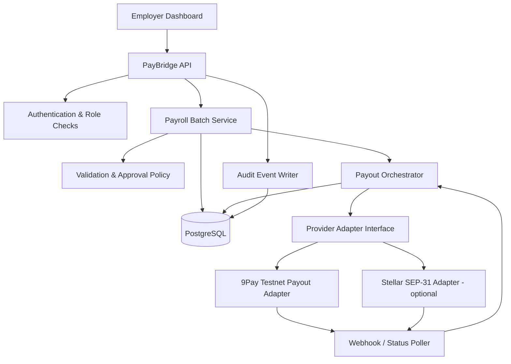
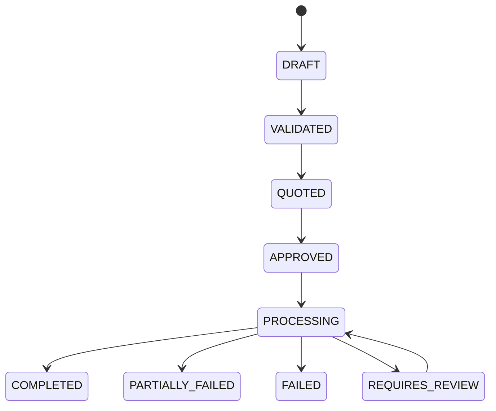

# PayBridge — Architecture

## 1. Mục tiêu

PayBridge là MVP giúp doanh nghiệp nước ngoài chuẩn bị, phê duyệt và theo dõi việc chi trả cho nhân viên/freelancer tại Việt Nam bằng crypto, với phạm vi demo tập trung vào **một batch payout**.

MVP ưu tiên một luồng end-to-end có thể chạy trên testnet/sandbox:
1. Doanh nghiệp nhập danh sách người nhận và số tiền.
2. Hệ thống kiểm tra dữ liệu và tổng ngân sách.
3. Người có quyền phê duyệt xác nhận batch.
4. Backend gửi lệnh qua provider adapter.
5. Hệ thống ghi nhận kết quả và hiển thị trạng thái.

**Không** xây payroll suite đầy đủ, multi-chain, token swap, liquidity engine, ZK payroll hay smart contract riêng trong MVP.

## 2. Ranh giới sản phẩm

### In scope
- Một doanh nghiệp/demo tenant.
- Một batch chứa nhiều người nhận.
- Một tài sản và một luồng payout được cấu hình cho demo.
- Tạo batch, validate, approve, execute, query status.
- Audit trail và chống gửi lệnh trùng.
- 9Pay testnet payout adapter, vì nhóm đã được cấp quyền chi hộ.
- Stellar SEP-31 adapter nếu đã chọn được anchor tương thích và có credentials/test environment.
- x402 chỉ đưa vào khi là yêu cầu bắt buộc của hackathon; không để nó làm phức tạp luồng payroll cốt lõi.

### Out of scope
- Tiền thật/production.
- Tự vận hành custody hoặc giữ private key của khách hàng.
- Tự xây KYC/AML engine.
- Tự phát hành stablecoin, exchange hoặc bridge.
- Tự động quy đổi crypto sang VND nếu provider/đối tác chưa xác nhận hỗ trợ.
- Tuyên bố sản phẩm làm cho việc trả lương bằng crypto tự động hợp pháp tại Việt Nam.

## 3. Kiến trúc mức cao

MCP, nếu cần, là một client-facing interface mỏng gọi cùng các use-case của API; không chứa logic payout riêng. x402 không nằm trên đường critical của lệnh trả lương trong MVP.

## 4. Thành phần

### 4.1 Employer Dashboard
- Tạo batch và nhập người nhận.
- Hiển thị tổng tiền, trạng thái validation, phí/quote nếu provider trả về.
- Cho phép người có quyền approve và execute.
- Hiển thị trạng thái theo từng người nhận và reference ID.
- Đánh dấu rõ dữ liệu testnet/mock.

### 4.2 PayBridge API
- Cung cấp REST endpoints.
- Xác thực người dùng và kiểm tra quyền.
- Điều phối các use case: create, validate, quote, approve, execute, status.
- Không tin cậy trạng thái từ frontend.
- Không trả API secrets hoặc thông tin nhạy cảm của provider về client.

### 4.3 Payroll Batch Service
- Quản lý batch và payout items.
- Tính tổng bằng decimal-safe arithmetic; không dùng floating-point cho tiền.
- Áp dụng state machine và các invariant.
- Chỉ cho execute batch ở trạng thái đã approve.
- Ghi audit events cho thay đổi trạng thái quan trọng.

### 4.4 Payout Orchestrator
- Chọn provider adapter đã cấu hình.
- Gửi lệnh với idempotency key ổn định.
- Lưu provider reference trước/sau khi gửi theo khả năng API.
- Xử lý timeout theo hướng “outcome unknown”; tra cứu trạng thái trước khi retry.
- Chuẩn hóa lỗi provider thành mã lỗi nội bộ.

### 4.5 Provider Adapter Interface
Interface khái niệm:
- `validateRecipient(input)`
- `getQuote(batch)`
- `submitPayout(batch, idempotencyKey)`
- `getPayoutStatus(providerReference)`
- `verifyWebhook(headers, body)` nếu provider có webhook.

Không giả định 9Pay và SEP-31 có cùng payload hoặc cùng semantics. Mỗi adapter chuyển đổi từ domain model sang provider-specific request.

### 4.6 9Pay Testnet Adapter
- Dùng credentials testnet được cấp quyền chi hộ.
- Xác minh chính xác endpoint, chữ ký, trường người nhận, amount/currency, idempotency, webhook và truy vấn trạng thái theo tài liệu tài khoản.
- Giữ secret trong environment variables/secret manager.
- Có mock adapter fallback nhưng phải hiển thị rõ “MOCK”; không được ghi mock success như giao dịch provider thật.

### 4.7 Stellar SEP-31 Adapter (optional for MVP)
SEP-31 là giao thức chuyển tiền giữa các bên/anchor tương thích; nó không tự đảm bảo có payout VND tại Việt Nam.
Chỉ bật adapter khi có anchor, asset, corridor và test environment đã xác minh. Nếu không, giữ adapter ngoài luồng demo chính và ghi là future integration.

### 4.8 MCP (optional thin interface)
Nếu cần trình diễn agent workflow, chỉ expose:
- `create_payout_batch`
- `validate_payout_batch`
- `get_payout_quote`
- `request_approval`
- `get_payout_status`

MCP không được bỏ qua quyền approve. Không expose tool tự do có thể chuyển tiền mà không có approval đã lưu.

## 5. Domain model

### PayrollBatch
- `id`
- `employerId`
- `status`: `DRAFT | VALIDATED | QUOTED | APPROVED | PROCESSING | COMPLETED | PARTIALLY_FAILED | FAILED | REQUIRES_REVIEW`
- `asset`
- `sourceAmountTotal`
- `feeTotal` (nullable nếu provider chưa có quote)
- `provider`
- `idempotencyKey`
- `createdAt`, `updatedAt`
- `approvedBy`, `approvedAt`

### PayoutItem
- `id`, `batchId`
- `recipientName` (chỉ lưu nếu cần)
- `recipientReference` (provider-specific identifier; hạn chế dữ liệu cá nhân)
- `amount`, `asset`
- `status`
- `providerReference`
- `failureCode`, `failureMessageSafe`

### AuditEvent
- `id`, `batchId`, `actorId`
- `eventType`
- `fromStatus`, `toStatus`
- `metadataRedacted`
- `createdAt`

Không ghi API secrets, private keys, full identity documents hay dữ liệu nhạy cảm vào audit log.

## 6. State machine và invariants

Quy tắc:
- Không execute khi chưa `APPROVED`.
- Batch đã `PROCESSING` hoặc terminal state không được submit lại như một batch mới.
- Mỗi payout item có idempotency key riêng hoặc key được provider hỗ trợ.
- Timeout không đồng nghĩa thất bại; trạng thái chưa rõ phải tra cứu provider trước khi retry.
- Chỉ đánh dấu `COMPLETED` khi có bằng chứng trạng thái thành công từ provider.
- Các thao tác quan trọng phải được ghi audit event.

## 7. API dự kiến

- `POST /api/batches` — tạo batch.
- `POST /api/batches/:id/validate` — validate recipients, amounts, totals.
- `POST /api/batches/:id/quote` — lấy quote nếu provider hỗ trợ.
- `POST /api/batches/:id/approve` — approve bởi user có quyền.
- `POST /api/batches/:id/execute` — submit batch đã approve.
- `GET /api/batches/:id` — batch và payout items.
- `GET /api/batches/:id/events` — audit trail.
- `POST /api/webhooks/9pay` — webhook nếu 9Pay cung cấp và tài liệu cho phép.

## 8. Security và secrets
- Không commit `.env`.
- Tách testnet credentials khỏi frontend.
- Validate request ở backend.
- RBAC tối thiểu: `EMPLOYER_ADMIN`, `APPROVER`, `VIEWER`.
- Kiểm tra chữ ký webhook theo tài liệu provider.
- Redact PII và token trong logs.
- Giới hạn amount và số recipient cho demo.
- Không dùng dữ liệu/tiền production trong hackathon.

## 9. Tech stack đề xuất
- TypeScript + Node.js.
- Next.js dashboard.
- Fastify (hoặc framework backend nhóm đã quen).
- PostgreSQL + Prisma; SQLite chỉ là phương án giảm setup nếu cần.
- Stellar SDK khi cần tích hợp anchor SEP-31.
- Provider SDK/HTTP client dựa trên tài liệu 9Pay testnet được cấp.
- Docker Compose cho local development.

Chọn công nghệ nhóm đã quen dùng; không đổi stack chỉ để theo kiến trúc này.

## 10. Các quyết định cần xác minh trước khi code provider
1. 9Pay testnet: endpoint chi hộ, auth/signature, amount/currency format, recipient fields, status query, idempotency và webhook.
2. Payout đích của 9Pay là gì và provider có hỗ trợ luồng tài sản được chọn không.
3. SEP-31: anchor cụ thể, asset, corridor, auth và test availability.
4. Hackathon có yêu cầu x402 bắt buộc không. Nếu không, loại khỏi critical path để giữ đúng một vấn đề: payout.
5. Ranh giới pháp lý/điều khoản của provider trước khi nói về production.

## 11. Ranh giới pháp lý
Bản demo chỉ chứng minh orchestration kỹ thuật trên testnet/sandbox. Tích hợp 9Pay testnet hoặc SEP-31 không tự xác nhận rằng mô hình trả lương bằng crypto được phép triển khai production tại Việt Nam. Trước production cần rà soát pháp lý, điều khoản provider, luồng tiền, ngoại hối, thuế, AML/KYC và vai trò của các bên liên quan.
