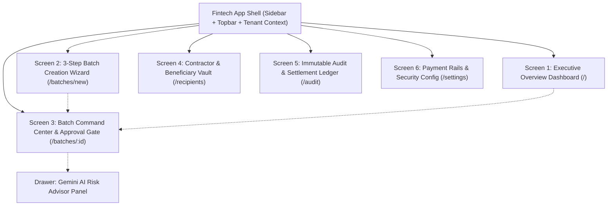

# Google Stitch UI/UX Design Specification & Master Prompts
**Project:** PayBridge — Cross-Border Contractor Settlement Service (Vietnam Domestic Rail)  
**Target Platform:** Google Stitch (AI-Native UI Prototyping & Design-to-Code)  
**Aesthetic Benchmark:** Stripe Treasury / Mercury B2B / Wise Business / Modern Institutional Fintech

---

## 1. Phân tích Trải nghiệm Người dùng & Kiến trúc Thông tin (UX Analysis)

### 1.1. User Personas & Mental Models
1. **Offshore Finance Director / CFO (Approver)**:
   - *Mục tiêu*: Cần nhìn thấy ngay tổng tiền (lossless integer VND), số lượng nhân sự, và tính hợp lệ của đợt thanh toán trước khi ký duyệt.
   - *Nỗi đau*: Sợ trả nhầm tài khoản, sợ chi trả kép (duplicate disbursement), sợ vi phạm hạn mức demo.
   - *Tương tác trong UI*: Cần thẻ duyệt nổi bật (**Dual-Control Approval Gate**), hiển thị rõ người tạo, thời gian, và cảnh báo rủi ro từ AI.
2. **Treasury / Operations Admin (Creator & Executor)**:
   - *Mục tiêu*: Nạp danh sách freelancer/nhân viên nhanh, tính tổng tự động, kiểm tra định dạng tài khoản ngân hàng (VCB, MB, Techcombank, ví 9Pay).
   - *Tương tác trong UI*: Wizard 3 bước với nút nạp nhanh dữ liệu mẫu 3 người, bảng nhập liệu có feedback trực quan.
3. **Compliance & Audit Officer (Auditor)**:
   - *Mục tiêu*: Theo dõi lịch sử giao dịch bất biến, đối soát mã tham chiếu provider (`MOCK-9PAY-TXN-...`), xác minh chữ ký approver.

### 1.2. Information Architecture (Sơ đồ Kiến trúc Màn hình)



---

## 2. Google Stitch Design System Tokens (`DESIGN.md` Specification)

### 2.1. Color Tokens & Semantic Meaning
- **Canvas Base**: `bg-slate-50/70` (`#F8FAFC`) — Nền xám nhạt trung tính, tạo độ sâu cho các thẻ trắng nổi.
- **Card Surfaces**: `bg-white` với `border-slate-200/80` và shadow tinh tế (`shadow-sm` đến `shadow-md`).
- **Sidebar & Header Hero**: `bg-slate-900` (`#0F172A`) với viền `border-slate-800` — Mang lại cảm giác quyền lực, tin cậy của phần mềm tài chính tổ chức.
- **Brand Primary Accent**: `indigo-600` (`#4F46E5`) -> hover `indigo-700` (`#4338CA`) — Dùng cho Primary CTA, active nav state.
- **Financial Status Colors**:
  - `APPROVED` / `COMPLETED`: Emerald (`bg-emerald-50`, `text-emerald-800`, `border-emerald-300`).
  - `VALIDATED`: Blue (`bg-blue-50`, `text-blue-800`, `border-blue-300`).
  - `TESTNET / SANDBOX`: Amber (`bg-amber-50`, `text-amber-800`, `border-amber-300`).
  - `REQUIRES_REVIEW`: Orange (`bg-orange-50`, `text-orange-800`, `border-orange-300`).
  - `FAILED`: Rose (`bg-rose-50`, `text-rose-800`, `border-rose-300`).

### 2.2. Typography & Numerical Precision
- Tiêu đề: `-apple-system, Inter, sans-serif`, `font-extrabold`, tracking chặt chẽ (`tracking-tight`).
- **Financial Monospace**: Tất cả số tiền (`15,000,000 VND`), số tài khoản ngân hàng (`9704050012345678`), và mã tham chiếu giao dịch (`MOCK-9PAY-TXN-...`) **bắt buộc** dùng `font-mono font-bold` để đảm bảo độ chính xác tài chính (lossless precision).

---

## 3. Bộ Google Stitch Prompts Chuẩn (Dùng trực tiếp trên Google Stitch)

Dưới đây là các prompt được thiết kế theo đúng định dạng tối ưu của **Google Stitch** để sinh ra giao diện hoàn chỉnh, sắc nét và liên kết flow chuẩn.

---

### Stitch Prompt 1: Global App Shell & Navigation Rail
```text
Role: Senior Fintech UI Designer
Style: Modern B2B Institutional SaaS (Stripe/Mercury inspired)
Component: Global App Shell with Responsive Sidebar & Top Navigation

Layout:
- Left-fixed dark sidebar (bg-slate-900, w-64, text-slate-300, border-r border-slate-800).
- Top brand header: Logo icon "PB" in vibrant indigo rounded-xl box, title "PayBridge", subtitle "VN Contractor Settlement".
- Prominent sandbox indicator badge: subtle amber pill with pulsing yellow dot: "9Pay Sandbox / Mock Mode - Zero Real Money".
- Vertical navigation menu items with clean stroke icons (lucide-react style):
  1. "Overview & Batches" (active state with indigo-600 pill background, white text)
  2. "New Payout Batch" (plus circle icon)
  3. "Contractor Vault" (users icon)
  4. "Audit & Compliance" (shield check icon)
  5. "Payment Rails & Config" (settings icon)
- Distinct AI section: "Gemini Risk Advisor" with sparkle amber icon and mini "AI" pill tag.
- Sidebar bottom footer: User avatar with initials "AG", company name "Acme Global Ltd", role "Admin & Approver".
- Main canvas topbar: white background, border-b border-slate-200, breadcrumb with building icon "Acme Global Ltd / Tenant ID: emp_acme_vn", live simulator active status badge, and primary CTA button "+ New Payout Batch" (indigo-600).
```

---

### Stitch Prompt 2: Screen 1 — Executive Overview & Batches Dashboard (`/`)
```text
Screen: Executive Overview & Payroll Batches Command Center
Path: /
Layout Structure:
1. Header Bar:
   - Title: "Payroll Batches Command Center" (font-extrabold, text-2xl text-slate-900).
   - Subtitle: "Prepare, audit, dual-approve, and disburse batched payouts to Vietnamese contractors."
   - Action controls: Refresh button, "⚡ Instant 3-Person Demo" quick trigger button (indigo-50 border-indigo-200 text-indigo-700), and "+ Create Payout Batch" (indigo-600).

2. Top Metric Cards (4 equal-width responsive grid):
   - Card 1: "Total Settled" -> Big bold font-mono value "125,500,000 VND", subtext "5 batch(es) completed" with green checkmark icon.
   - Card 2: "Pending Approval" -> Bold value "2", subtext "Requires dual-control sign-off" with clock icon.
   - Card 3: "Drafts in Prep" -> Bold value "1", subtext "Pre-validation stage" with trending icon.
   - Card 4: "Settlement Rail" -> Title "9Pay Testnet (Chi Hộ)", subtext "Simulator 100% Operational" with pulsing green indicator.

3. Batches Table Container:
   - Horizontal tab filters: "All Batches (6)", "Draft (1)", "Validated (2)", "Approved (1)", "Completed (2)".
   - Dense data table:
     * Column headers: Batch Title & Reference, Beneficiaries, Batch Lossless Total, Disbursement Rail, Status, Created Date, Action.
     * Rows: Interactive hover state, clicking row navigates to /batches/:id.
     * Total amount displayed in prominent bold monospace font.
     * Status column uses rounded pill badges (Blue for VALIDATED, Emerald for APPROVED/COMPLETED, Slate for DRAFT).
     * Action button: "Command Center →" with indigo-50 styling.
   - Empty state fallback: friendly card with money icon, title "No Payroll Batches Found", prompt button "+ Create First Batch".
```

---

### Stitch Prompt 3: Screen 2 — 3-Step Batch Creation Wizard (`/batches/new`)
```text
Screen: New Payout Batch Wizard
Path: /batches/new
Layout Structure:
1. Stepper Navigation Header:
   - Horizontal 3-step progress bar with numbered circles:
     Step 1: "Specification" (Batch title, currency rail, cost center)
     Step 2: "Recipient Roster" (Beneficiaries, bank routing, individual amounts)
     Step 3: "Budget Audit" (Pre-flight validation, lossless math audit)
   - Quick action: "⚡ Load 3 Sample Recipients" button in header to auto-populate Vietnam test recipients (Nguyen Van A - VCB, Tran Thi B - MB, Le Hoang C - 9Pay Wallet).

2. Step 1 View: Form with input for Batch Title, fixed Asset pill "VND via 9Pay Rail", Originating Tenant "Acme Global Ltd", and Audit Memo.
3. Step 2 View: Interactive editable roster:
   - Multiple rows, each containing: Beneficiary Full Name, Account/Wallet Phone Number, Routing Bank dropdown (VCB, MB, TCB, ACB, 9Pay E-Wallet), Amount (VND) with strict integer validation, and delete trash icon.
   - "+ Add Row" button.
   - Dynamic real-time calculation box at bottom: "Computed Roster Total: [Sum in monospace VND] (Lossless BigInt arithmetic)".
4. Step 3 View: Pre-flight Audit Summary:
   - 3 highlight metric boxes: Batch Total (Verified Lossless), Total Beneficiaries (Persons), Target Rail (9Pay Sandbox Chi Hộ).
   - Review table with masked accounts.
   - Prominent Amber Invariant Alert: "Dual-Control Invariant: Creating this batch will register it in DRAFT status. It cannot be executed until an authorized Approver signs off."
   - Confirm button: "Confirm & Register Draft Batch 🚀".
```

---

### Stitch Prompt 4: Screen 3 — Batch Command Center & Dual-Control Gate (`/batches/:id`)
```text
Screen: Batch Command Center & Dual-Control Approval Gate
Path: /batches/:id
Layout Structure:
1. Header Bar:
   - Back button arrow, Batch Title (font-extrabold), StatusBadge (DRAFT / VALIDATED / APPROVED / COMPLETED), Batch ID, and Idempotency Key.
   - Buttons: "Refresh Status" and "🤖 AI Risk Review".

2. Settlement Pipeline Visualizer (4-node horizontal interactive track):
   - Node 1: "1. Draft Batch" (Roster & amounts entered)
   - Node 2: "2. Validated" (Recipients & totals audited)
   - Node 3: "3. Executive Approved" (Signed by executive approver)
   - Node 4: "4. 9Pay Dispatched" (Settlement completed via testnet)
   - Current active node highlighted in glowing primary color.

3. Dual-Control Action Center (High-contrast dark luxury banner):
   - Dark gradient background (from-slate-900 to-indigo-950), shield check gold icon.
   - Dynamic instructional text based on status:
     * If DRAFT: "Step 1: Run pre-flight verification on contractor bank routing accounts." -> Blue button "Validate Accounts (Step 1)".
     * If VALIDATED: "Step 2: Dual-control approval. An authorized finance officer must sign off prior to dispatch." -> Emerald button "Executive Approve (Step 2)".
     * If APPROVED: "Step 3: Ready for execution. Dispatch payment batch to the 9Pay testnet chi hộ adapter." -> Vibrant Indigo button "Execute 9Pay Payout (Step 3)".
     * If COMPLETED: Green pill "✅ Settlement Complete & Reconciled".

4. Tabbed Content Container:
   - Tab 1: "Contractor Beneficiary Ledger": Table showing Recipient Name, Routing Account, Bank Code, Amount, Item Status, and Provider Transaction Reference ("MOCK-9PAY-TXN-...").
   - Tab 2: "Audit Trail & Idempotency": Chronological event cards showing timestamp, Actor ID, Event Type (BATCH_CREATED, BATCH_VALIDATED, BATCH_APPROVED, BATCH_EXECUTION_COMPLETED), and State transitions.
   - Tab 3: "Gemini Risk Advisor": Intelligent natural language analysis, amount distribution check, tax warnings, and explicit compliance boundary disclaimer.
```

---

### Stitch Prompt 5: Screen 4 — Contractor & Beneficiary Vault (`/recipients`)
```text
Screen: Contractor & Beneficiary Directory
Path: /recipients
Layout Structure:
1. Header:
   - Title: "Contractor & Beneficiary Vault"
   - Subtitle: "Verified Vietnamese contractors, freelancers, and staff bank routing profiles."
   - Primary action: "+ Add Beneficiary" (opens registration modal).

2. Metrics Row (4 cards):
   - "Active Beneficiaries": 5 contractors.
   - "Bank Verification": 4 / 5 Pre-flight Verified.
   - "Supported Banking Rails": VCB, MB, TCB, ACB, 9Pay.
   - "Dual-Control Audit": Enforced on all payouts.

3. Filter & Search Toolbar:
   - Search input with magnifying glass: "Search by contractor name, account number, or role...".
   - Bank Rail dropdown filter: All Banks, Vietcombank (VCB), MB Bank (MB), Techcombank (TCB), ACB, 9Pay Wallet.

4. Beneficiary Table:
   - Columns: Contractor (Avatar with initials + Name), Role & Email, Bank Rail badge, Account / Wallet Phone (monospace), Verification Status (Verified pill with checkmark), Lifetime Disbursed (VND).
5. Add Beneficiary Modal: Clean popup form with Full Name, Role, Email, Bank Selector, and Account Number.
```

---

### Stitch Prompt 6: Screen 5 — Immutable Audit & Compliance Ledger (`/audit`)
```text
Screen: Audit & Settlement Compliance Ledger
Path: /audit
Layout Structure:
1. Header:
   - Title: "Audit & Compliance Settlement Ledger"
   - Subtitle: "Cryptographically timestamped, append-only records of every state transition, dual-control approval, and provider callback."
   - Badge: Green checkmark "Immutable Append-Only Log".

2. Invariant KPI Cards:
   - "Recorded Transitions": Total event count.
   - "Dual-Control Signatures": Count of BATCH_APPROVED checkpoints.
   - "PII / Secret Redaction": "100% Redacted - Zero credentials stored".

3. Event Log Table:
   - Filter by Event Type dropdown (ALL, BATCH_CREATED, BATCH_VALIDATED, BATCH_APPROVED, BATCH_EXECUTION_STARTED, BATCH_EXECUTION_COMPLETED).
   - Columns: Timestamp (monospace), Event Type tag (indigo pill), Batch link, Authorized Actor ID (font-mono), State Transition (fromState → toState), Redacted Metadata JSON snippet.
```

---

### Stitch Prompt 7: Screen 6 — Payment Rails & Security Config (`/settings`)
```text
Screen: Payment Rails & Platform Invariants Settings
Path: /settings
Layout Structure:
1. Section 1: Disbursement Providers & Settlement Rails:
   - 3 Provider Cards:
     * Card 1: "9Pay Vietnam" -> Tag "Testnet Chi Hộ", Base URL sandbox.9pay.vn, HMAC checksum slot ready.
     * Card 2: "Mock Payout Simulator" -> Tag "Active (Demo)", Delay 500ms, Deterministic success rate.
     * Card 3: "Stellar SEP-31 Rail" -> Tag "Future / Conditional", Out of MVP critical path.

2. Section 2: Financial Invariants & Security Architecture Matrix (4 grid cards with green check icons):
   - "Lossless Monetary Representation": BigInt and numeric strings, zero floating point.
   - "Approval Invariant (BR-01 / FR-07)": Execution blocked until approved by authorized role.
   - "Idempotency Deduplication (FR-12)": Network retries return existing batch safely.
   - "Zero Secrets in Git (NFR-01)": Pure environment variable isolation, redacted logs.

3. Section 3: Gemini AI Advisor Safety Protocol:
   - Explains the strict isolation: Read-only advisory mode, zero execution authority.
```

---

## 4. Hướng dẫn sử dụng trên Google Stitch

1. **Tạo Project mới trên Google Stitch**: Đặt tên `PayBridge Fintech Portal`.
2. **Import Design Tokens**: Tải nội dung Section 2 của tài liệu này hoặc file `DESIGN.md` vào phần Design System Tokens của Stitch.
3. **Sinh từng màn hình**: Copy lần lượt các **Stitch Prompt 1 đến 7** ở Section 3 vào ô prompt của Stitch.
4. **Liên kết luồng (Prototyping Interaction)**:
   - Nút `+ New Payout Batch` ở Topbar & Dashboard → mở `Screen 2 (/batches/new)`.
   - Nút `Confirm & Register Draft Batch` ở Wizard Step 3 → chuyển sang `Screen 3 (/batches/:id)`.
   - Nút `Validate Accounts (Step 1)` → cập nhật Stepper lên bước 2.
   - Nút `Executive Approve (Step 2)` → cập nhật Stepper lên bước 3.
   - Nút `Execute 9Pay Payout (Step 3)` → hoàn thành Stepper lên bước 4 và hiển thị mã tham chiếu.
   - Tab bên trái chuyển đổi giữa Dashboard (`/`), Danh bạ (`/recipients`), Sổ cái (`/audit`), và Cấu hình (`/settings`).
